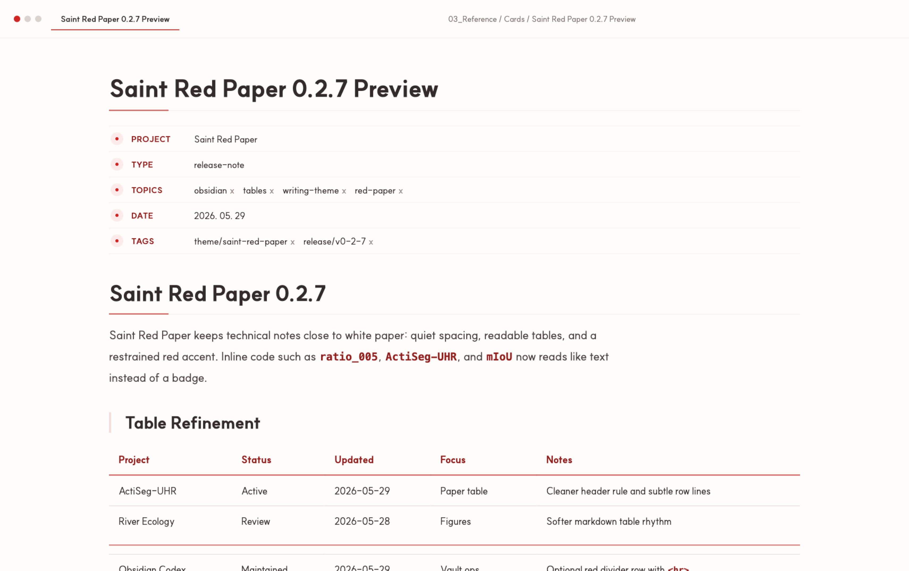
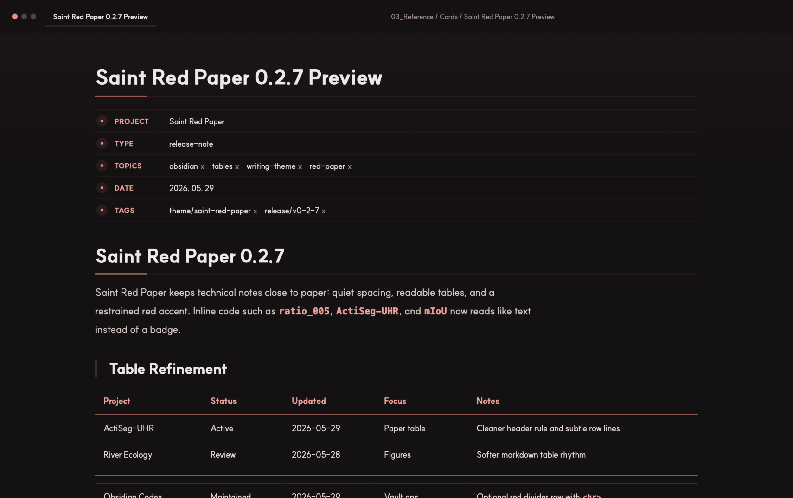

# Saint Red Paper

Saint Red Paper is a light-first Obsidian theme for research notes, lab logs, and long-form technical writing. It keeps light mode as the primary visual identity, but now also includes a matching dark mode so the same note structures remain usable when the workspace switches to dark.

<div align="center">

<a href="https://community.obsidian.md/themes/saint-red-paper">Obsidian Community Theme</a> · <a href="https://github.com/saint0721/saint-red-paper/stargazers">Star on GitHub</a> · <a href="https://github.com/saint0721/saint-red-paper/issues">Issues</a>

[](https://community.obsidian.md/themes/saint-red-paper)
[](https://github.com/saint0721/saint-red-paper/stargazers)

<strong>If Saint Red Paper fits your workflow, please star the repo.</strong>

</div>



Saint Red Paper is available in the official Obsidian Community directory. Feedback, bug reports, and workspace screenshots are always welcome in [Issues](https://github.com/saint0721/saint-red-paper/issues).

## What It Changes

- Keeps the main canvas close to white paper instead of tinting the whole workspace
- Tunes headings, spacing, blockquotes, callouts, and inline code for reading-heavy notes
- Gives sidebars, root tabs, links, tags, and notices a restrained red-paper language
- Adds a paper-like treatment for Markdown and Dataview tables so they feel closer to notes than widgets
- Supports optional red table dividers with a simple `<hr>` marker row
- Offers research-writing options for paper-like notes and PDF export (see [Research writing](#research-writing))
- Keeps Live Preview close to reading view: heading rules, table spacing, list bullets, and the reference list look the same while you write
- Extends the same visual language into a matching dark mode instead of leaving dark as a token-only fallback
- Adds a compact optional styling layer for `Agent Client` controls when that plugin is installed
- Fits well with `make.md`'s `Navigator` panel if you want the workspace captures to feel closer to the author's setup
- Includes built-in `Style Settings` hooks for width, rules, sidebar accents, links, tags, and table density
- Still behaves predictably even if `Style Settings` is not installed
- Installs from the standard Obsidian theme files, `theme.css` and `manifest.json`

## Quick Install

Requires Obsidian `1.1.9` or later.

### Obsidian Community Themes

1. Open `Settings -> Appearance -> Themes -> Manage`.
2. Search for `Saint Red Paper`.
3. Install and select the theme.

### Manual

1. Copy this folder into your vault's `.obsidian/themes/Saint Red Paper/` directory.
2. Open `Settings -> Appearance -> Themes`.
3. Select `Saint Red Paper`.

### Git clone

```bash
git clone https://github.com/saint0721/saint-red-paper.git "Saint Red Paper"
```

Then move or symlink the folder into `.obsidian/themes/Saint Red Paper/`.

### Optional plugins

The theme works without extra plugins. These plugins are only recommended if you want a setup closer to the screenshots:

- `Style Settings` for adjusting exposed theme variables from the UI
- `Dataview` if you want result tables like the ones shown in the demo captures
- `Agent Client` if you want matching visual treatment for chat controls
- `make.md` if you want the `Navigator` panel layout shown in the author's workspace

### Optional plugin-specific styling

Saint Red Paper can style a few third-party plugin surfaces when those plugins already exist in the user's vault. The theme does not bundle plugin functionality; it only provides visual integration where safe.

Important:

- The theme does **not** bundle `Agent Client` or any other plugin functionality.
- Users still need to install those plugins separately.
- What the theme can provide is visual integration, not plugin features.

## Best Fit

Saint Red Paper is designed for:

- research notes
- lab notebooks
- proposal drafts
- long-form technical writing
- clean light-mode daily knowledge work

It is a weaker fit for dashboard-heavy, card-heavy, or heavily gamified workspace styles.

## Recommended setup

- Fonts: `Noto Serif KR` for note text (Hangul) and `SUIT` for the interface; Latin note text uses Times New Roman
- Interface mode: Light
- Accent color: `#cd2623` if you want the OS-level accent to sit close to the theme palette
- Snippets: Disable older overlapping table/sidebar snippets once this theme is enabled

## Research writing

Saint Red Paper includes options for writing notes that read and print like a paper. Turn them on in `Settings -> Style Settings -> Saint Red Paper`. All of them are optional, and the defaults keep the theme's usual look.

### Options in Style Settings

| Section | Option | What it does | Default |
| --- | --- | --- | --- |
| Links and Tags | Link color preset | `Theme red` or `Academic blue` for links and citation numbers | Theme red |
| Tables | Table style | `Paper` or `IEEE` (rules above and below the header and after the last row, width fits the content) | Paper |
| PDF export | Keep blocks together in PDF | Headings never sit alone at the bottom of a page; short tables, figures, callouts, and code stay on one page; long tables repeat their header | On |
| Academic | Break Korean lines between words | Korean text wraps between words, so a word is never split across lines | On |
| Academic | Justify body text | Paragraphs and list items align to both edges | Off |
| Academic | Smaller table text | Table text one step smaller than body text | Off |
| Academic | Paper-style footnotes | Small superscript marks; the footnote list sits under a short rule in smaller text | Off |
| Academic | Paper-style abstract callout | `> [!abstract]` becomes an indented block with a centered Abstract heading | Off |
| Academic | Reference list layout | A list right after a heading named References, Bibliography, 참고문헌, or 출처 drops its bullets and uses a hanging indent | On |
| Academic | Number headings, tables, and figures in PDF | H2 becomes `1.`, H3 `1.1`, tables and images get `Table n` / `Figure n` | Off |
| Academic | Table label / Figure label | Words used in those labels, for example `Tab.` and `Fig.`, or `표` and `그림` | Table / Figure |
| Academic | Plain internal links in PDF | Links to other notes print as plain text, since they do not open outside the vault | Off |
| Academic | Horizontal rule starts a new PDF page | A `---` line becomes a page break in PDF | Off |
| Academic | Paper title in PDF | A leading `# Title` (or the exported file name) prints centered and larger | Off |

If your headings already carry numbers such as `## 1. Introduction`, leave heading numbering off, or the PDF will show `1. 1. Introduction`.

### Writing citations, captions, and cross-references

These conventions are plain Markdown, so the note stays readable anywhere.

```md
Recent models fail outside their training distribution [3], and planners exploit model errors [1, 2].

Table: Mismatch between human and AI time scales {#tab:layers}

| Layer | Human | AI |
| --- | --- | --- |
| Control | tens of ms | a few Hz |

![[setup.png|Test cell layout {#fig:cell}]]

As @tab:layers and @fig:cell show, ...

## References
- \[1\] Author, Title, Venue, Year.
- \[2\] Author, Title, Venue, Year.
- \[3\] Author, Title, Venue, Year.
```

| You write | You see |
| --- | --- |
| `[3]`, `[1, 2]` | A citation number in the link color |
| `Table: caption` (or `표: 설명`) on the line above a table | A centered table title, numbered `Table 1. caption` when numbering is on |
| `![[image.png\|caption]]` | A caption under the image, numbered `Figure 1. caption` when numbering is on |
| `{#tab:name}`, `{#fig:name}` at the end of a caption | A name for the table or figure (hidden in the view) |
| `@tab:name`, `@fig:name` in the text | The current number, for example `Table 1`; a name that does not exist shows in red |
| A list under `## References` with `\[n\]` entries | A paper-style reference list |

Write the reference numbers as `\[1\]` so Obsidian does not read `[1]` as a checkbox.

### Companion plugin: SRP Citations

An Obsidian theme is CSS only: it can style what Obsidian puts on the page, but it cannot run code or install a plugin for you. So the features that need to read the note (citations, captions, cross-references, renumbering) live in the small companion plugin **SRP Citations**, shipped in this repository. Without it, the theme still colors citation numbers in Live Preview and lays out the reference list in reading view.

To install it:

1. Download `srp-citations.zip` from the [latest release](https://github.com/saint0721/saint-red-paper/releases/latest).
2. Unzip it into your vault's `.obsidian/plugins/` folder, so that you have `.obsidian/plugins/srp-citations/manifest.json` and `main.js`.
3. Open `Settings -> Community plugins`, reload the list if needed, and turn on `SRP Citations`.

The plugin source is in [`plugin/srp-citations`](plugin/srp-citations).

| Feature | Theme only | With SRP Citations |
| --- | --- | --- |
| Citation numbers in the link color | Live Preview | Live Preview, reading view, PDF |
| Click a citation to jump to its reference | No | Yes |
| Hover a citation to preview the reference | No | Yes |
| Table and figure captions | No | Live Preview, reading view, PDF |
| Cross-references `@tab:` / `@fig:` | No | Live Preview, reading view, PDF |
| Reference list layout in Live Preview | No | Yes |
| Command `Renumber citations by first appearance` | No | Renumbers `[n]` in the text by first appearance and reorders the reference list to match; uncited entries move to the end |
| Estimated PDF page count in the status bar | No | Yes; references are excluded, and the PDF export scale is taken into account. It runs a little low, because page breaks before headings and tables are not counted |

## Dark mode preview



## Markdown table dividers

Saint Red Paper supports an optional red divider row inside Markdown tables. Add a blank table row where you want the divider, then put `<hr>` in the first cell:

```md
| Project | Status | Updated |
| ------- | ------ | ------- |
| A       | Done   | Today   |
| <hr>    |        |         |
| B       | Todo   | Tomorrow |
```

The theme hides the `<hr>` text and renders that row as a red horizontal divider across the table. Plain empty rows stay plain; the divider appears only where the `<hr>` marker is used.

## Exposed Style Settings controls

- Note width
- Paragraph width
- Inline title rule width
- H1 rule width
- Sidebar active accent
- Sidebar active background
- Sidebar edge shadow opacity
- Link color, link hover color, and the link style preset
- Table style (Paper or IEEE)
- PDF export and Academic options (see [Research writing](#research-writing))
- Tag shape
- Table vertical padding
- Table outer border color

## Maintenance Checklist

Before cutting a release, verify:

- Reading View and Live Preview both look correct
- Dataview tables do not reintroduce conflicting backgrounds
- No legacy snippets are still overriding table or sidebar styles
- `Style Settings` controls remain optional rather than required
- The current Obsidian version still respects the selectors used in `theme.css`
- Optional plugin-specific styling degrades safely when the target plugin is not installed

## Included Files

- `theme.css`: Built Obsidian theme file
- `manifest.json`: Obsidian theme manifest
- `assets/main-light.png`: Main live light workspace capture
- `assets/main-dark.png`: Main live dark workspace capture
- `assets/saint-red-paper-community.png`: Community directory preview capture
- `plugin/srp-citations/`: Companion plugin for citations, captions, and cross-references (also attached to each release as `srp-citations.zip`)
- `CHANGELOG.md`: Release notes

## Links

- Homepage: https://github.com/saint0721/saint-red-paper
- Issues: https://github.com/saint0721/saint-red-paper/issues

For release history, see [CHANGELOG.md](CHANGELOG.md).
